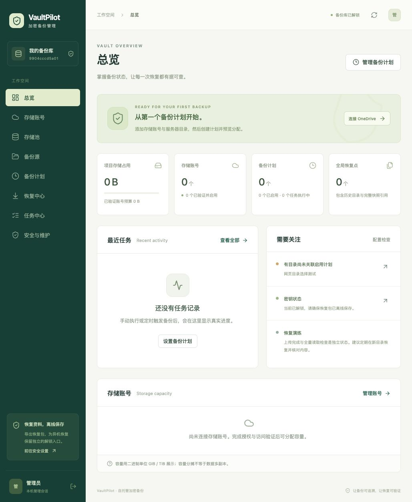

# VaultPilot

中文多账号 OneDrive 加密备份管理平台。技术栈：Go、Vue 3 / TypeScript、SQLite、Restic 0.18.1、Rclone 1.70.3。一个独立 Restic 仓库完整存放在一个 Drive 中，按稳定文件集合分配容量；多账号容量分摊不提供业务数据多副本。

项目按 [需求规格](多账号%20OneDrive%20加密备份平台.md) 开发。实现与验证范围以 [测试报告](docs/TEST_REPORT.md) 和 [已知限制](docs/LIMITATIONS.md) 为准。真实 OneDrive Personal、多 TB 和百万文件的测试需要对应环境；本地引擎测试不能替代云端验收。

## Debian 12 / Docker Compose

需要 Docker Engine、Compose 插件和至少两个可参与存储池的 OneDrive 账号。默认采用 Rclone 标准授权，无需开通 Azure 或注册微软应用。公开访问请在 HTTPS 反向代理后部署。不要把宿主机根目录或 Docker Socket 挂载给应用。

```sh
git clone https://github.com/nXiaoK/vaultpilot.git
cd vaultpilot
cp .env.example .env
# 编辑 .env：真实源目录、恢复目录、运行 UID/GID；Rclone 标准授权可保留 OAuth 配置为空。
mkdir -p state cache example-data/source example-data/restore
# 让 .env 中指定的 UID/GID 能写入 state/cache/恢复目标，能读取备份源。
sudo chown -R 1000:1000 state cache example-data/restore
chmod 700 state cache
docker compose build
docker compose up -d
```

默认仅监听宿主机 `127.0.0.1:8080`。访问 `http://localhost:8080`，创建管理员和独立恢复密码，添加账号并逐一授权、明确选择 Drive、完成读写验证，然后创建存储池、备份源和计划。首轮备份后立即导出并离线保存恢复包，执行一次恢复演练后再扩大规模。

在 VPS 部署时，可以在自己的电脑运行 `ssh -L 8080:127.0.0.1:8080 <用户>@<VPS地址>`，再从浏览器访问 `http://localhost:8080`。Rclone 标准授权遇到 localhost 回调打不开时，在网页中粘贴完整回调地址即可。使用域名访问时请配置 HTTPS 反向代理，并设置 `VP_PUBLIC_URL`。

生产环境替换 `.env` 的 `VP_SOURCE_HOST` 与 `VP_RESTORE_HOST`。源以只读方式挂载到 `/sources`；恢复目标独立挂载到 `/restore`。新增宿主机目录需要更新 compose 的只读挂载和 `VP_SOURCE_ROOTS`，重建容器后才会出现在网页选择器中。

## OneDrive 授权（无需 Azure）

在「存储账号 → 添加账号」创建名称，默认选择「Rclone 标准授权」，打开微软页面，用 Microsoft 365 Family 的个人账号登录并同意权限。成功后选择实际 Drive 并完成读写验证。

Rclone 的标准回调固定为 `http://localhost:53682/`。本机运行通常自动接收；VPS 或 Docker 部署时，授权后可能显示“无法访问此网站”，复制该页地址栏完整地址，回到 VaultPilot 粘贴并提交即可。无需暴露服务器的 53682 端口。每次授权有效 10 分钟，同一实例依次授权账号。

也可选择「导入 Rclone 配置」，上传未加密的 `rclone.conf`、`rclone config dump` JSON，或粘贴 `rclone authorize onedrive` 的输出。解析预览后显式选择 remote；每次导入一个账号，随后从真实微软响应中选择 Drive 并验证。详细步骤见 [Rclone 授权指南](docs/RCLONE_AUTH.md)。

## 可选：自定义微软应用注册

仅当希望使用自己的应用时配置 `VP_OAUTH_CLIENT_ID`、`VP_OAUTH_CLIENT_SECRET`。在 Microsoft Entra 应用注册中选择适合个人账号的账户类型，添加 Web 回调：`<VP_PUBLIC_URL>/api/oauth/callback`，填写 Client ID 和适用的 Client Secret。应用使用授权码、state、PKCE 和离线权限。公开 URL、注册回调与实际访问地址必须一致；开发环境可使用微软允许的 localhost 回调。

网页授权结束后必须手动选择 Drive。授权成功不代表该 Drive 通过备份访问验证；例如 `ODCMetadataArchive` 不能被自动当成业务存储。企业版及 SharePoint 未经真实验收不承诺支持。

## 开发与本地验证

需要 Go 1.26、Node 20.20+、Restic 和 Rclone。可以把引擎安装到 PATH，或通过环境变量指定绝对路径。

```sh
cd web
npm ci
npm run build
cd ..
go build -o bin/vaultpilot ./cmd/vaultpilot
go test -race ./...
VP_RESTIC_BIN=/path/to/restic VP_RCLONE_BIN=/path/to/rclone ./bin/vaultpilot
```

API 同源提供编译后的 `web/dist`。开发前端可单独运行 `npm run dev`，Vite 将 `/api` 代理到 Go 服务。

本地真实引擎闭环（两个文件目录模拟存储入口，并非 OneDrive）：

```sh
python3 scripts/e2e_local.py --extended --restic /path/to/restic --rclone /path/to/rclone
```

此脚本会创建隔离测试源、执行加密备份、修改删除与重命名，再彻底移除原数据库/缓存和业务源，以恢复包在新状态目录发现登记并恢复新旧版本，核对 SHA-256。测试专用本地账号仅在 `VP_ALLOW_LOCAL=true` 时开放，生产 compose 默认关闭。

扩展用例包括全局历史清理、整仓迁移与旧副本安全清理、覆盖冲突、离线账号部分恢复。随后可用 `python3 scripts/e2e_rescue.py test-artifacts/e2e-<该轮时间> --restic /path/to/restic` 验证独立工具人工恢复；`python3 scripts/smoke_docker.py` 验证隔离非 root 容器。

## 界面预览

以下截图来自实际初始化后的本地测试实例，尚未连接云账号；业务数据由 API 返回。



## 文档

- [架构决策](docs/ARCHITECTURE.md)、[任务状态机](docs/STATE_MACHINE.md)、[恢复协议](docs/RECOVERY_PROTOCOL.md)
- [部署与配置](docs/CONFIGURATION.md)、[恢复手册](docs/RECOVERY.md)、[安全边界](docs/SECURITY.md)
- [API](docs/API.md)、[OpenAPI](docs/openapi.yaml)、[数据库迁移](docs/MIGRATIONS.md)
- [验收计划](docs/ACCEPTANCE.md)、[测试报告](docs/TEST_REPORT.md)、[已知限制](docs/LIMITATIONS.md)
