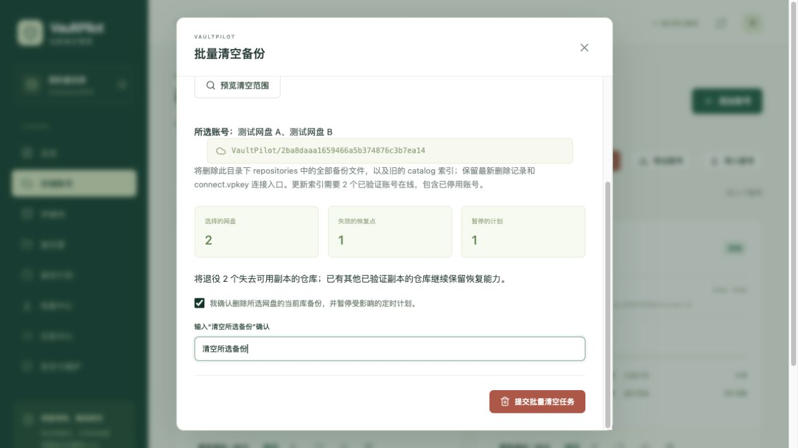

# 批量清空测试备份

更新并重新构建部署后，在备份写入节点进入「存储账号 → 批量清空备份」。支持一个网盘、多选或全选已验证账号；账号卡片的橡皮擦图标可直接选中单个账号。

1. 解锁备份库，等待所有排队或执行中的任务结束。需要清空的账号先完成访问验证。
2. 选择账号并点击「预览清空范围」。核对账号名称/邮箱、当前备份库目录、失效恢复点、退役仓库和将暂停的计划。项目占用是上次配额查询值，不是本次实时测量或承诺释放的字节数。
3. 涉及受保护恢复点时，先在恢复中心明确取消保护，再重新预览。修改账号、授权、计划或恢复点后，旧预览会失效。
4. 勾选删除与暂停计划的确认项，输入 **清空所选备份**，再提交后台任务。
5. 在任务中心查看每个账号的结果。清空完成后，定时计划保持暂停；核对存储池与容量，然后手动启用计划或发起新备份。

## Google Drive 的永久删除

所选账号包含 Google Drive 时，预览会显示危险提示：**Google Drive 中的备份将被永久删除，不进入回收站，无法找回**。每个预览项的 `permanent_delete` 为 true 表示该账号采用永久删除。平台固定 `use_trash = false`，导入 Rclone 配置中的相反设置不会覆盖它。历史清理/prune 和迁移旧副本清理也遵循相同规则。

删除范围仍限定当前库的项目数据，不会清空整个 Google Drive。配额刷新和空间释放速度尚未在真实 Google 账号上验收。

## 实际删除范围

仅删除所选账号中当前库的 `VaultPilot/<vault_id>/repositories` 全部内容（包括没有成功发布恢复点的仓库残留），并回收所选账号当前库的旧 catalog 索引。路径由服务器根据当前库构造，API 不接受自定义根目录或 Rclone 过滤规则。

保留网盘个人文件、其他备份库、本地备份源、账号配置和授权、存储池、备份源与计划配置。保留当前库的 `connect.vpkey` 连接入口与最新认证删除目录记录，因此项目占用可能还有少量元数据，不承诺显示为 0 B。任务和审计记录保留。

失去最后一个已验证副本的仓库会退役，相关完整恢复点失效，并清除这些恢复点的本机文件索引及退役仓库的稳定归属记录。一个恢复点跨多个网盘时，清空其中一个网盘也可能使整个恢复点失效；其他网盘的数据文件不会因此一并删除。若仓库在未选网盘仍有已登记、已验证的副本，服务将有效位置切换到该副本，保留相应恢复点。清空不重新验证备份副本内容；副本可用性仍以已有验证记录与后续恢复校验为准。

## 失败、中断与多节点

服务先持久化退役记录并暂停受影响计划，再要求所有已登记且已验证的不同 Drive（包括已停用账号）上传并读回新的认证目录，最后才删除备份文件。因此，**更新删除记录需要这些账号在线**。缺失授权或目录提交不完整时不会开始删除云端数据；已经持久化的退役状态会保留，等待重试。

任务执行期间禁止启动其他备份、恢复与维护任务，也禁止修改计划或恢复点保护。删除不能作为跨多个云盘的原子操作，失败、取消或重启前可能已经清空部分账号。未完成状态会持久化，重启后仍禁止其他任务；「存储账号」会显示继续清理提示，也可从失败任务的「重新预览清空」返回。修复授权、网络或权限问题后，**选择上次的同一组账号**重新预览并执行；重复清理已删除的目录是安全的。

恢复节点没有清空入口。B/C 发现最新认证目录后，已清空的恢复点不再显示为有效备份。离线节点或尚未发现最新目录的节点可能仍展示旧缓存，应重新执行云端发现后再判断。OneDrive 的清空保留既有 Rclone 删除行为，不会自动清空微软回收站；Google Drive 清空永久删除。两者均可能受配额统计延迟或人为删除最新目录影响。

本功能继续遵循单写入节点要求，不提供跨服务器删除锁。清理时不要在另一台机器运行同一备份库的写入节点。

