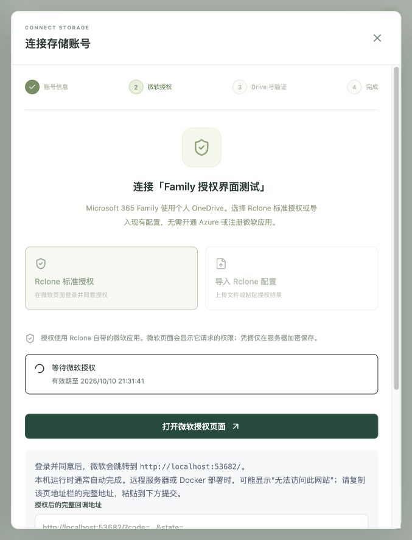
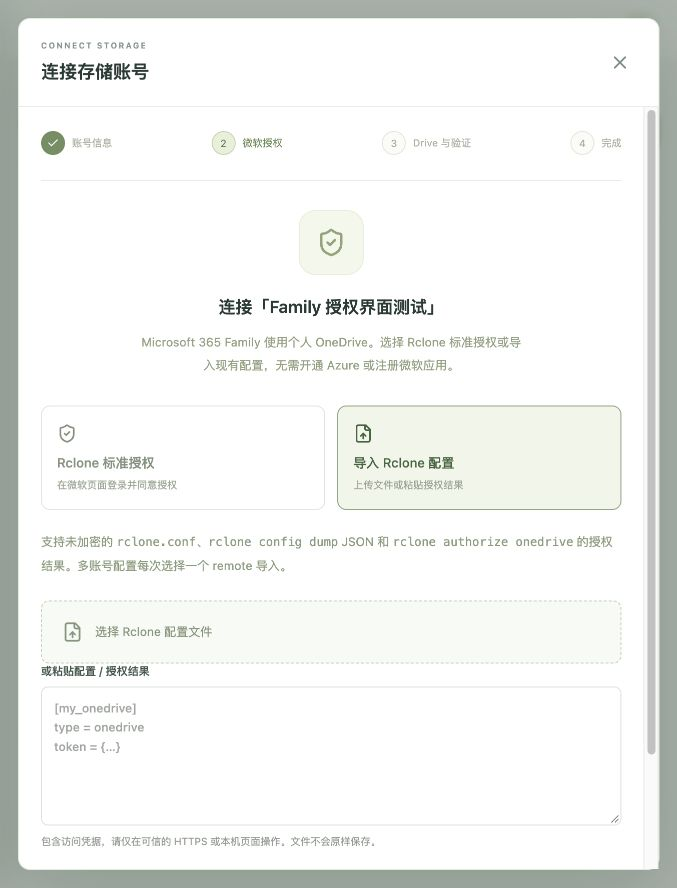

# OneDrive 可视化授权与配置导入

Microsoft 365 Family 属于个人订阅，可以使用 Rclone 自带的微软应用连接个人 OneDrive。默认不需要 Azure 账号，也不需要填写客户端 ID、密钥或自行注册回调地址。

## 方式一：在网页中使用标准授权

1. 打开「存储账号」，点击「添加账号」，填写便于辨认的名称并继续。
2. 保持默认「Rclone 标准授权」，点击「开始 Rclone 标准授权」。服务器启动实际 Rclone，界面出现微软授权按钮。
3. 点击「打开微软授权页面」，在新页中选择对应的个人微软账号，检查权限并同意。Family 中各成员要分别使用自己的微软账号授权。
4. 微软跳转到 `http://localhost:53682/`。如果 VaultPilot 直接运行在这台电脑上，通常自动完成；返回原页即可。
5. 远程服务器或 Docker 部署时，浏览器可能显示“无法访问此网站”。保留这一页，从地址栏复制包含 `code` 和 `state` 的完整 URL，回到原页，粘贴到「授权后的完整回调地址」并提交。此步骤不需要在服务器公开 53682 端口。
6. 平台加密保存授权结果并读取真实 Drive 列表。手动选择 Personal Drive，设置容量预算，点击「验证访问并保存预算」。只有实际读写和配额验证通过后，账号才能加入存储池。

每次授权有效 10 分钟，同一实例同时仅支持一个标准授权。可随时取消并重新开始；关闭对话框会请求取消。浏览器异常关闭或断网时，服务端最多等待到授权过期。端口占用、网络不可达、用户拒绝、微软限制或授权过期时，页面显示失败，可重新尝试或导入已有配置。不要把回调地址发给他人。

## 方式二：导入已有 Rclone 配置

1. 创建账号并继续，切换到「导入 Rclone 配置」。
2. 上传未加密的 `rclone.conf` 或 dump JSON，也可以粘贴授权结果。上限 1 MiB。
3. 点击「解析并预览可导入账号」。列表仅显示名称、应用来源和 Drive 参考信息，不回传 Token。
4. 显式选择一个 remote，点击「加密保存并读取 Drive」。一份多账号配置可重复操作，每次对应一个平台账号。
5. 从微软返回的真实列表选择 Drive 并完成读写验证。导入文件中的 Drive ID 不会自动成为已验证身份。

支持以下内容：

- 未加密 INI 配置：包含 `[名称]`、`type = onedrive` 与 `token = {...}`。已有自定义应用的 `client_id`、obscure 格式的 `client_secret` 和受支持刷新设置会与 Token 一起加密保存。
- `rclone config dump` 的 JSON 输出。
- `rclone authorize onedrive` 输出中的 Token JSON，或官方 Base64 配置授权结果；可以粘贴完整的输出标记段。

没有现成配置、又希望在本机 Rclone 中授权时，在有浏览器的电脑安装 Rclone，并运行 `rclone authorize onedrive`，将输出粘贴到上述网页入口。默认网页标准授权无需执行这条命令。

配置须包含可刷新的 `refresh_token`、Bearer Token 类型和过期时间。到期后由服务器上的 Rclone 使用该账号原有应用刷新。加密的 Rclone 配置需先在原电脑解密；入口不索要其加密密码。只支持全球区 Personal，暂不接入 Business、SharePoint 或其他区域。无关的配置选项不会用于执行任意命令或请求任意端点。

## 已有账号重新授权

在已有账号的连接入口重新标准授权或导入即可。重新授权后会要求再次验证；已有账号必须选择原 Drive，以保护历史仓库的位置身份。连接其他 Family 成员的 Drive，应添加新的账号。重新授权不会删除云端备份。

## 可选自定义应用

已有微软应用的部署者仍可设置 `VP_OAUTH_CLIENT_ID`、`VP_OAUTH_CLIENT_SECRET`、`VP_PUBLIC_URL` 和 `VP_OAUTH_TENANT`。配置后，授权界面的「高级」选项提供原网页授权方式，其回调是 `<VP_PUBLIC_URL>/api/oauth/callback`。该路径与 Rclone 标准授权独立，不是默认方案的前置条件。

## 界面示例

以下截图来自隔离测试节点，未完成真实微软账号授权。

## 微软账号身份

存储卡片保留自定义名称，并显示 Microsoft Graph 返回的邮箱或显示名。已有账号可点击“重新授权 / 验证”读取账号身份，或刷新配额读取 Drive 所有者信息；不必重新登录微软。缺少 User.Read 权限时身份读取失败不阻断 Drive 选择，未提供邮箱时显示名称或身份未读取提示。重新授权会清空旧身份，避免误标。相同稳定 Drive ID 的多个别名合并为一个选择项，优先显示 OneDrive 名称。
