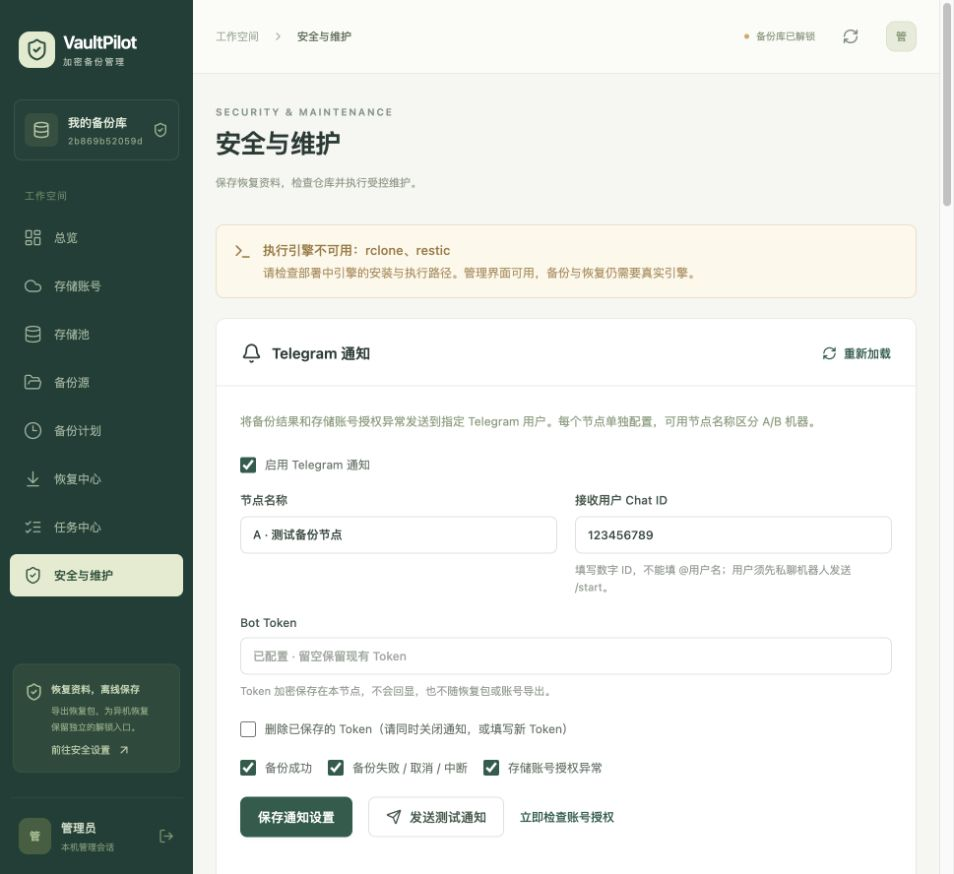
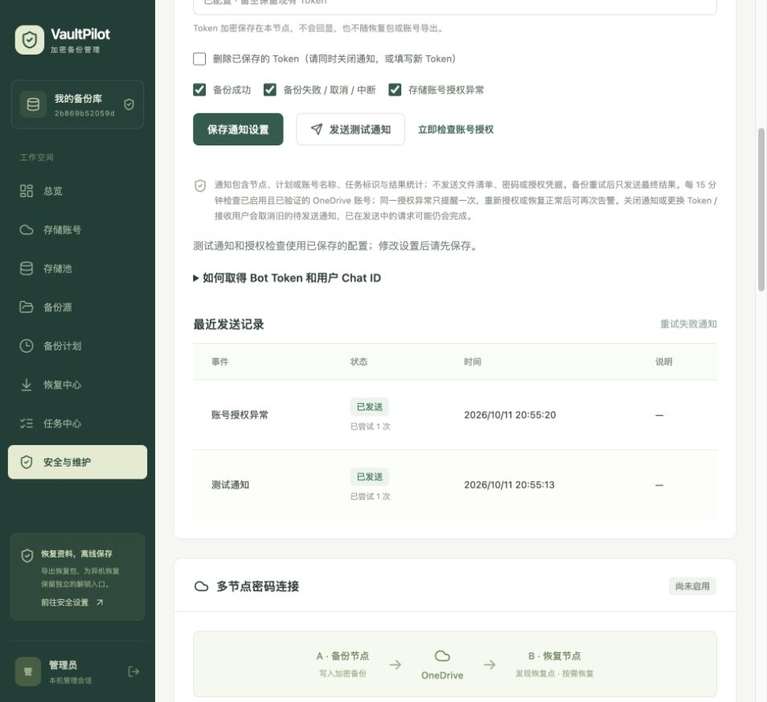

# Telegram 通知

更新并重新构建部署后，进入「安全与维护 → Telegram 通知」。默认关闭，每个节点独立配置，无需新增环境变量。

## 设置机器人与接收用户

1. 在 Telegram 找到官方 **@BotFather**，发送 `/newbot`，按提示创建机器人并复制 Bot Token。
2. 接收用户打开新机器人的私聊，发送 `/start`。机器人不能主动联系从未发起私聊的用户。
3. 在自己的浏览器打开 `https://api.telegram.org/bot<Token>/getUpdates`，将 `<Token>` 替换为 Token。在该用户消息的 `message.chat.id` 中取得数字 ID。结果为空时，向机器人再发一条消息后刷新。不要分享含 Token 的地址。已配置 webhook 的机器人不能使用 `getUpdates`，请从已有机器人服务取得 Chat ID，无需删除 webhook。
4. 填入节点名称、Token、个人用户的数字 Chat ID，开启通知并选择事件，再保存。当前每节点支持一个个人用户，不接受 `@用户名` 或群组 ID。
5. 点击「发送测试通知」，核对 Telegram 和发送记录。「已排队」表示创建成功；「已发送」表示 Telegram API 接受消息，不代表用户已读。

保存后 Token 输入框清空，只显示「已配置」。再次保存留空保留原 Token；删除 Token 时需同时关闭通知或填写新 Token。测试、重试、授权检查使用已保存的设置。

## 事件与检测范围

- **备份成功**：完整任务完成后发送节点、计划、任务 ID、结束时间、处理量、上传量及用时。
- **备份失败 / 取消 / 中断**：重试结束后只发送最终结果，取消和重启中断也作为异常。预览、恢复和维护任务不触发备份通知。详细错误在任务中心查看，不发送原始错误或日志。
- **账号授权异常**：实际 Graph 存储请求的 401/403、凭据不可用/到期且无法续期、刷新失败、Rclone/自定义 OAuth 授权失败，以及引擎明确的授权拒绝。消息指出账号名称与 ID。可选 `/me` 身份查询缺少权限不会触发网盘授权告警；取消授权不通知。

开启账号异常通知后，启动时和每 15 分钟对**已启用、已验证、有 Drive ID 的 OneDrive 账号**进行只读访问检查，也可手动检查。普通 access token 到期且自动刷新成功不会告警；普通网盘网络错误不会被标为授权失效。刷新失败提示检查网络或重新授权，不等于微软已撤销授权。

同一账号异常持久化去重，重启不重复告警。重新授权或成功访问验证解除异常；401/刷新失败在定期只读检查成功后也解除。403 可能只影响写入，读取成功不解除此类异常，需要重新授权或成功访问验证。

## 发送失败与安全

通知通过持久化后台队列发送，不改变备份结果。请求超时 10 秒，网络错误、服务异常、限流最多尝试 8 次，限流遵守 `retry_after`。无效 Token、Chat ID、用户未 `/start` 或屏蔽机器人等明确错误停止自动重试，并显示处理提示。修复原因后点击「重试失败通知」，或更换配置后发送新的测试通知。

重启后继续发送，并补入启用期间最近 30 天内已结束但未入队的备份结果，不补发启用前的历史。已发送/取消记录保留约 30 天，成功发送后清除正文；待发送/失败正文用节点密钥加密。采用至少一次投递：Telegram 已接受而响应丢失，或本地记账前退出时，重试可能产生重复消息。

关闭通知或更换 Token/接收用户会取消旧的待发送和失败通知，重新启用不补发这些旧事件；已经开始发送的请求仍可能完成。关闭某事件后，尚未发送的此类消息不继续发送。

Token 与配置使用 `node-key` 加密保存，API 不回显 Token，日志不输出含 Token 的请求地址或原始接口错误。设置不进入恢复包、云端控制目录或账号导出，B 节点需单独配置。备份库锁定不阻止通知工作。正文包含必要的节点/计划/账号名称和统计，不包含文件清单、密码、OneDrive 凭据或原始引擎日志。

服务器需能通过 HTTPS 连接 `api.telegram.org`。真实 Bot/用户的端到端接收需部署者通过测试通知验收。

